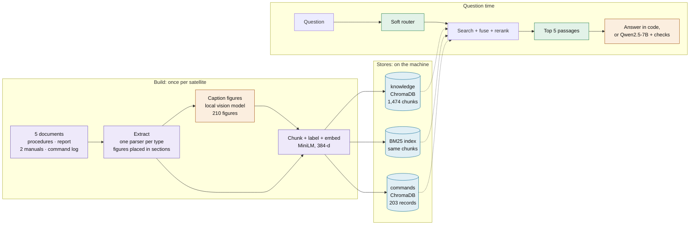
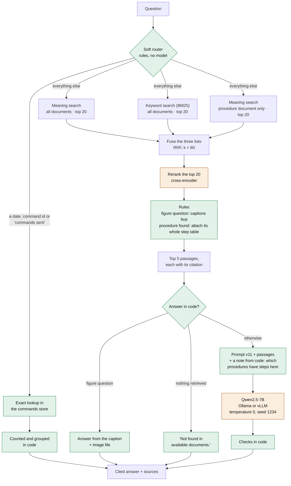
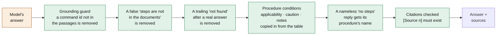
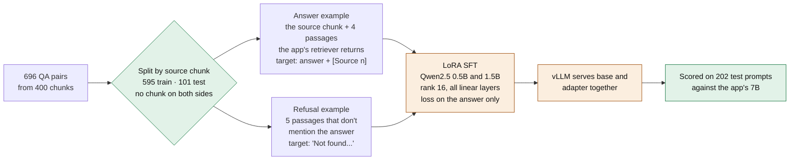
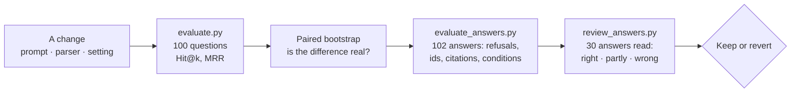

# SatelliteRAG

**Ask questions of spacecraft operations documents and get cited answers, fully offline.**
Flight control procedures, mission reports, manuals, figures and the telecommand log, searched together, answered by a local model, and checked in code before anyone reads the answer.


Built for the Aditya-L1 mission's operations documents, and works for any satellite: drop its documents in a folder and build.

---

## Contents

- [What it does](#what-it-does)
- [Results at a glance](#results-at-a-glance)
- [How it works](#how-it-works)
  - [System map](#system-map)
  - [What happens to one question](#what-happens-to-one-question)
  - [How the three searches are fused](#how-the-three-searches-are-fused)
  - [Checks after the model](#checks-after-the-model)
- [Fine-tuning: a RAFT-style adapter](#fine-tuning-a-raft-style-adapter)
- [Ollama or vLLM](#ollama-or-vllm)
- [How every change is checked](#how-every-change-is-checked)
- [Quick start](#quick-start)
- [Repository layout](#repository-layout)
- [Documentation](#documentation)
- [Reference](#reference)

---

## What it does

| Question | What comes back | Model used? |
| --- | --- | --- |
| "How do I reset the onboard computer?" | The procedure's steps with every command id exactly as written, plus its applicability, pre-requisites, caution and notes, cited | Yes, then checked in code |
| "Which procedure covers gyro power-on?" | The procedure's number and title from the index | Yes |
| "What does the star sensor do in normal mode?" | A cited answer from the report and manuals | Yes |
| "Show me the recovery diagram" | The figure's caption, its section and the image file | No, answered from the caption |
| "Which commands were sent on 2026-06-09?" | Every matching record, counted and grouped | No, counted in code |
| A question the documents don't cover | "Not found in available documents." | Yes, or in code if nothing was retrieved |

Everything runs on the machine: parsing, figure captioning, embedding, search and answering. No cloud service and no API key.

---

## Results at a glance

Measured on a labelled set of 100 questions written against the documents, and on the answers the app writes for them. Full method and every number: [`docs/PROJECT_WALKTHROUGH.md`](docs/PROJECT_WALKTHROUGH.md).

**Retrieval** (17 November 2026, default settings)

| Hit@1 | Hit@3 | Hit@5 | Hit@10 | MRR | 95% interval |
| --- | --- | --- | --- | --- | --- |
| 84% | 91% | 93% | 97% | **0.880** | 0.822 to 0.932 |

| Stage | Hit@1 | Hit@5 | MRR |
| --- | --- | --- | --- |
| Meaning search only (MiniLM) | 77% | 89% | 0.825 |
| Keyword search only (BM25) | 76% | 90% | 0.824 |
| Both, fused with RRF | 80% | 95% | 0.862 |
| Fused, then reranked (as shipped) | **84%** | 92% | **0.879** |

**Answers** (102 questions through the app, prompt v11)

| Measure | Result |
| --- | --- |
| Command ids invented by the model | **0**: the code guard has never had to remove one from a real answer |
| Procedure answers that carry their caution and conditions | 7 of 7 (copied in code) |
| Out-of-scope questions refused | 2 of 2 |
| 30 answers read against their passages | 17 right · 8 partly right · 1 wrong · 4 over-refused |

**Serving**: one question takes the same time on Ollama and vLLM (1.50 s against 1.47 s, 7B fp16). With many questions at once, vLLM does 2.1× the work, and answer quality is the same (84 of 102 answers word for word identical).

**Fine-tuning**: a 1.5B model fine-tuned RAFT-style cites the right passage more often than the app's 7B (84 against 69 of 101) and refuses correctly more often (74 against 67 of 101). [Details below](#fine-tuning-a-raft-style-adapter).

---

## How it works

### System map



### What happens to one question



Green steps are decided in code; orange ones call a model. Two kinds of question never reach the language model: a figure request is answered from its caption (a text model asked to "show" a figure says it can't), and a command-log lookup is counted in code (a whole day of records used to overflow the context).

### How the three searches are fused

The **soft router** never guesses whether a question is "about a procedure". Instead, every question also gets a meaning search restricted to the procedure document, and all three ranked lists are fused with **Reciprocal Rank Fusion**:

```
score(chunk) = Σ over the lists it appears in of  1 / (60 + its rank in that list)
```

| Chunk | Meaning search | Keyword search | Procedure search | Score |
| --- | --- | --- | --- | --- |
| A | 1st | 3rd | - | 1/61 + 1/63 = 0.0323 |
| B | - | 1st | - | 1/61 = 0.0164 |
| C | 2nd | 2nd | 2nd | 3 × 1/62 = **0.0484**, top |

Being found by several searches beats being first in one, and only ranks are used, so a cosine score and a BM25 score never have to be compared.

The third list exists because most procedures appear only as a one-line index entry (`FCP 5203 - OBC - OBC SYSTEM RESET`). A 40-character line loses to long manual paragraphs in both normal searches, even when it's an exact title match, and drops out of the candidate pool. Ranked among procedure chunks only, it gets a fair place and rises on its own merit. The alternative "rules" router forces procedure chunks to the top instead, and scored lower (MRR 0.850 against 0.883 on the 12 November store; on today's store the gap is smaller and within the noise, so soft is the best estimate rather than a proven winner).

### Checks after the model



An invented command id is the most dangerous failure in operations, and a prompt alone can't rule it out, so the code checks every id against the passages. A procedure's caution is copied by code too, not left to the model: reading answers showed the model dropping it even when asked.

---

## Fine-tuning: a RAFT-style adapter

The app answers with Qwen2.5-7B as downloaded. Fine-tuning was studied separately, in two rounds, to see whether a small model could learn the app's job ([`lora/`](lora), walkthrough chapter 10).

**Round 1: question → answer, no passages.** A 0.5B model was trained on 595 question-and-answer pairs written by the 7B from the documents. Its token F1 rose from 0.14 to 0.40, but reading its 40 test answers found 2 right: it learned the documents' **style**, not their **facts**, and its wrong answers sounded right. Facts belong to retrieval.

**Round 2: LoRA SFT on retrieval-augmented examples, RAFT-style.** The model is trained on the app's real task: the app's system prompt, five retrieved passages and a question in; a cited answer out.



| Model | Right (of 101) | Cites a right passage | Refuses correctly (of 101 unanswerable) |
| --- | --- | --- | --- |
| The app's Qwen2.5-7B | 72 | 69 | 67 |
| Qwen2.5-1.5B, no adapter | 65 | 6 | 25 |
| **Qwen2.5-1.5B + adapter** | 59 | **84** | **74** |
| Qwen2.5-0.5B + adapter | 29 | 50 | 37 |

Training took 355 s for the 1.5B (1.18% of its weights) on an RTX PRO 5000.

What it shows: trained on its real task, a 1.5B model cites and refuses better than the 7B. It also learned the reference answers' brevity, which costs detail an operator needs (an action named without the three commands that carry it out). It is not used in the app.

**How it relates to RAFT** ([Zhang et al., 2024](https://arxiv.org/abs/2403.10131)):

| | RAFT | This adapter |
| --- | --- | --- |
| Right passage among distractors | Yes | Yes |
| Distractors | Sampled from the corpus | The app's own retriever, so they look relevant |
| Examples with no right passage | Still answer (memorise) | **Refuse**, because the app must answer only from its passages |
| Answer format | Quote the passage, then answer | Short answer + citation (quote-then-answer is the next step) |

---

## Ollama or vLLM

Every model call goes through [`core/llm.py`](core/llm.py); one environment variable switches the server, and sampling is sent explicitly so both give the same answers.

| | Ollama | vLLM |
| --- | --- | --- |
| One question (7B fp16, lab GPU) | 1.50 s | 1.47 s |
| 102 questions, 8 at once (paired runs) | 1× | **2.1×** |
| Answer quality | same | same (84 of 102 identical) |
| 7B on a 6 GB laptop GPU (partly on CPU) | **8.6 s** | 28.1 s |
| Figure captioning | 1× (2 slots) | **4×** |

So Ollama stays the default for one person and small GPUs, and vLLM is for batch work and several users. A browser demo ([`demo/`](demo)) sends the same question and passages to both and shows them side by side.

---

## How every change is checked



Answer prompts are versioned and kept word for word (v1 and v6 to v11 in [`core/generate.py`](core/generate.py), v2 to v5 in [`bench/prompts/`](bench/prompts)); each change records why it was made and what it measured. 46 checks in [`tests/test_answering.py`](tests/test_answering.py) cover the parts decided in code, on made-up data.

---

## Quick start

```powershell
# 1. PyTorch first, matching your CUDA version (nvidia-smi), then the rest
pip install torch --index-url https://download.pytorch.org/whl/cu128
pip install -r requirements.txt

# 2. Models: the embedder, and the local text and vision models
python cli.py prefetch minilm-l6
ollama pull qwen2.5:7b-instruct
ollama pull qwen2.5vl

# 3. Public demo documents (4 public ISRO/ISSDC documents about Aditya-L1)
python scripts/fetch_adityal1_docs.py

# 4. Build the stores and ask
python cli.py build aditya-l1
python cli.py query aditya-l1 "What payloads does Aditya-L1 carry?"
```

The operations documents the system was built and measured on are not in this repository. The public demo documents have no procedures or command log, so they show retrieval and answering, not the procedure and command-log features. Step-by-step setup: [`SETUP.txt`](SETUP.txt).

---

## Repository layout

```
SatelliteRAG/
├── cli.py                  build, query, shell: the command line
├── core/                   the pipeline
│   ├── registry.py         satellites, document detection, settings
│   ├── extract.py          documents → sections, procedures, records, figures
│   ├── layout.py           figure placement; the structure-aware parser (off by default)
│   ├── caption.py          figure descriptions with a local vision model
│   ├── chunking.py         per-document-type splitting
│   ├── embeddings.py       offline embedding model registry
│   ├── ingest.py           embed into ChromaDB + BM25
│   ├── router.py           rules / soft / llm question routing
│   ├── retrieve.py         dense + BM25 + RRF, procedure handling
│   ├── rerank.py           the cross-encoder reranker
│   ├── generate.py         prompts v1–v11, answers made in code
│   ├── grounding.py        the checks after the model
│   └── llm.py              one client for Ollama and vLLM
├── demo/                   browser page: Ollama and vLLM side by side
├── lora/                   fine-tuning: closed-book and RAFT-style adapters
├── bench/                  the Ollama-vs-vLLM benchmark
├── tests/                  46 checks on the code-decided parts
├── docs/                   walkthrough, before/after record, context
├── results/                summary tables of every measurement
├── evaluate*.py            retrieval, answer and router evaluation
├── review_*.py             pages for reading answers and captions by eye
└── satellites/<name>/      one folder per satellite (documents not in git)
```

---

## Documentation

| File | What's in it |
| --- | --- |
| [`docs/PROJECT_WALKTHROUGH.md`](docs/PROJECT_WALKTHROUGH.md) | The whole project in build order, 11 chapters: parsing, chunking, captions, embedding, retrieval, routing, answering, evaluation, Ollama vs vLLM, fine-tuning, the demo |
| [`docs/CHANGES_BEFORE_AFTER.md`](docs/CHANGES_BEFORE_AFTER.md) | Each change, with what it looked like before and after |
| [`docs/PROJECT_CONTEXT.md`](docs/PROJECT_CONTEXT.md) | Architecture, design decisions, measured numbers |
| [`docs/COMPARISON.md`](docs/COMPARISON.md) | This system against the earlier pipeline |
| [`docs/GIT_SETUP.md`](docs/GIT_SETUP.md) | Running it after cloning |
| [`bench/README.md`](bench/README.md) | The Ollama-vs-vLLM benchmark method and results |
| [`demo/README.md`](demo/README.md) | The side-by-side browser demo |

---

## Reference

<details>
<summary><b>Adding a satellite</b></summary>

```powershell
python cli.py new chandrayaan-3
# copy documents into satellites\chandrayaan-3\documents\
python cli.py scan chandrayaan-3      # check each file's type was recognised
python cli.py build chandrayaan-3     # extract + caption + ingest
python cli.py query chandrayaan-3 "how to switch on OBC"
```

There is no configuration to fill in: each file's type is recognised from its name. `satellite.yaml` is only needed to override a default (embedding model, chunk sizes) or to map a file the patterns can't recognise:

```yaml
documents:
  FCP:
    file: some_unusual_name.pdf
```

</details>

<details>
<summary><b>Which filenames are recognised</b></summary>

| Type | Matched by |
| --- | --- |
| FCP | "FCP", "flight control procedure" |
| MOR | "MOR", "mission operations", "mission plan", "mission report" |
| OPS_MANUAL | "operations manual", "ops manual", "manual" |
| GUIDELINES | "guidelines", "guidance", "normal phase" |
| TCH | "TCH", "telecommand", "command history", or any .txt |

Case, underscores and camel case don't matter: `AL1OperationsManual.docx`, `ops_manual.docx` and `CH3-Operations-Manual.docx` all resolve to OPS_MANUAL.

</details>

<details>
<summary><b>What build does</b></summary>

| Stage | What it does | Run alone |
| --- | --- | --- |
| extract | Reads each document with its parser: procedure index rows and step tables, report sections, Word sections and tables, one record per telecommand. Saves figures and places each in its section. | `python cli.py extract aditya-l1 --force` |
| caption | Describes each figure with the local vision model, using its section heading and nearby text, and stores the description as a searchable chunk. Resumes if interrupted. | `python cli.py caption aditya-l1` |
| ingest | Cuts sections to size, labels and embeds them, writes ChromaDB and the BM25 index. | `python cli.py ingest aditya-l1 --reset` |

</details>

<details>
<summary><b>Chunking</b></summary>

| Document | Max characters | Overlap | Prefers to cut at |
| --- | --- | --- | --- |
| FCP | 2,500 | 200 | end of procedure, notes, blank line |
| MOR | 1,000 | 150 | blank line, sentence end |
| OPS_MANUAL, GUIDELINES | 1,200 | 200 | blank line, sentence end |
| index rows, captions, command records | never split | | |

A structure-aware parser (paragraphs and table rows kept whole, headers repeated on split tables) is built in and switched off: it made much cleaner chunks but did not move the retrieval score. Turn it on per satellite with `parsing: {mode: structure}`.

</details>

<details>
<summary><b>Querying: one question, a shell, or a file of questions</b></summary>

```powershell
python cli.py query aditya-l1 "What are Aditya-L1's science objectives?"
python cli.py query aditya-l1 "VELC payload" --doc-types OPS_MANUAL MOR
python cli.py query all "Aditya-L1 payloads"          # search every satellite
python cli.py shell aditya-l1                         # many questions, models loaded once
python cli.py query aditya-l1 --file questions.txt    # one question per line
```

| Flag | Effect |
| --- | --- |
| `-k <n>` | how many passages to retrieve (default 5) |
| `--doc-types T ...` | restrict to these document types |
| `--subsystem S` | restrict to one subsystem |
| `--no-answer` | show the retrieved sources only |
| `--show-text` | print the retrieved text, not just citations |
| `--model NAME` | a different text model for the answer |

In the shell: `:sat <slug|all>`, `:k <n>`, `:doc <TYPE ...>`, `:text`, `:exit`.

</details>

<details>
<summary><b>Choosing the model server</b></summary>

```powershell
$env:SATRAG_LLM = "vllm"                        # default: ollama
$env:SATRAG_VLLM_URL = "http://localhost:8000/v1"
$env:SATRAG_LLM_CONCURRENCY = "4"               # batch jobs: several requests in flight
```

vLLM runs on Linux or WSL2 only. Temperature 0, a fixed seed and a repetition penalty of 1.0 are sent on every request, so an answer doesn't depend on a server default. Answers are capped at 768 tokens.

</details>

<details>
<summary><b>Embedding models</b></summary>

| Name | Dimensions | Note |
| --- | --- | --- |
| minilm-l6 | 384 | default; fastest, level with the best 1024-d models once fused with BM25 |
| bge-m3 | 1024 | multilingual, long context, heavy |
| bge-large-en | 1024 | strong English-only |
| mxbai-large | 1024 | strong English-only |
| gte-large-en | 1024 | needs trust_remote_code |
| e5-large | 1024 | multilingual, prefixes handled automatically |

Set per satellite with `embedding: {model: bge-m3}`. Satellites may use different models; results across satellites are fused by rank, not score.

</details>

<details>
<summary><b>All commands</b></summary>

```
python cli.py models                    embedding model registry
python cli.py prefetch <name> ...       download models
python cli.py new <slug>                scaffold a satellite folder
python cli.py list                      state of every satellite
python cli.py scan [<slug>]             check document detection
python cli.py build <slug|all>          extract + caption + embed
python cli.py extract <slug|all>        documents to JSON
python cli.py caption <slug|all>        describe figures
python cli.py ingest <slug|all>         embed into the vector store
python cli.py query <slug|all> "..."    one-shot question
python cli.py shell <slug|all>          interactive questions
python demo/server.py aditya-l1         browser demo, Ollama and vLLM side by side
```

</details>
